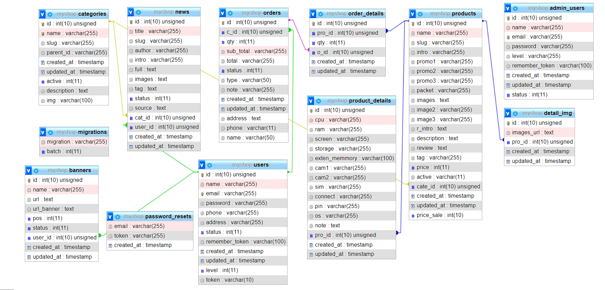

# Laravel Phone/Device Store

Website bán thiết bị (điện thoại) xây dựng bằng Laravel, đồ án môn **Phát triển phần mềm mã nguồn mở**.

## Cài đặt & chạy

1. `composer install && npm install`
2. Copy `.env.example` thành `.env`, chỉnh `DB_*` khớp MySQL local, chạy `php artisan key:generate`.
3. Tạo database `myshop`, import `database/myshop.sql`.
4. `php artisan serve --port=8000`
5. Mở `http://localhost:8000/`.

Khuyến nghị chạy ở độ phân giải màn hình ≥ 1280x900.

## Database

## Demo

## Thành viên nhóm

Minh Hiếu Calan Tog, Huỳnh Chí Cường, Bùi Minh Trí, Nguyễn Thanh Hưng.
